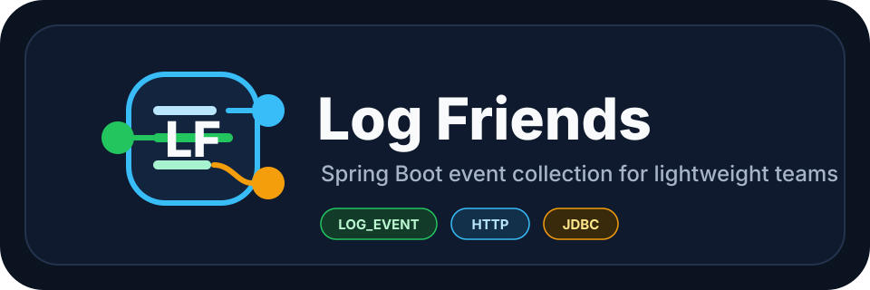

<p align="center">
  
</p>

# Log Friends

**서비스 데이터를 수집하고, 에이전트와 대화하며 데이터 확인부터 모델 비교까지 이어가는 셀프호스팅 플랫폼입니다.**

어떤 이벤트가 있는지 찾고, 학습에 무엇이 부족한지 확인하고, 여러 모델의 결과를 비교하는 작업을 한 흐름으로 연결합니다.

> 로컬 개발 구현을 기준으로 작성했습니다. 설명된 기능이 GitHub 기본 브랜치, 공개 패키지, 배포 이미지에 모두 포함된다는 뜻은 아닙니다. 각 저장소의 버전과 구현 범위를 함께 확인하세요.

## 어떻게 사용하나요?

1. **로그인하고 앱을 등록합니다.** Console에서 앱 이름·고정 Worker·버전을 설정하고 앱 키를 발급합니다.
2. **SDK를 연결하고 수집 범위를 정합니다.** JVM 앱에는 앱 키와 환경을 설정합니다. 데이터 카탈로그에서 API별 수집을 켜면 사용자의 실제 API 호출 시 이벤트를 수집합니다. 과거 데이터를 자동으로 가져오는 기능은 아닙니다.
3. **에이전트에게 목표를 설명합니다.** 이벤트 정의와 샘플을 탐색하고 필요한 이벤트·필드의 보완을 제안받습니다.
4. **검증된 학습 계획을 확인하고 승인합니다.** 지원하는 합성 주문 취소 시나리오에서는 전체 대상 데이터의 연결·중복·정답·시간 분할을 검증하고, 데이터 조건에 맞는 여러 모델을 비교합니다.
5. **결과를 보고 개선합니다.** 승인된 CPU Job의 비교 결과와 한국어 분석을 확인합니다. 반복 개선도 사용자가 승인한 범위에서 수행합니다.

## 역할은 어떻게 나뉘나요?

```text
고객 서비스 + SDK
       |
       | HTTP JSON batch (최대 50 이벤트)
       v
Kotlin Console ------------------> PostgreSQL / TimescaleDB
       |
       +-- Spring AI: 탐색 · 검증 도구 · 모델 비교 제안
       +-- 사용자 승인 확인 ------> 제한된 Kubernetes CPU Job
       ^
       | 화면 요청 / 결과
Console Web
```

- **에이전트**는 데이터를 살피고 보완·비교 계획을 제안합니다.
- **Kotlin Console**은 인증·소유권·대화 저장·데이터 검증·승인 상태·Job 실행을 담당합니다.
- **사용자**는 수집 정책과 학습 실행을 결정합니다. Console Web에는 화면과 요청 전달을 둡니다.

## 어디서 시작하나요?

| 저장소 | 용도 |
|---|---|
| [Console](https://github.com/log-freind/log-friends-console) | DB 연결, 인증·앱 등록, Spring AI, 검증·학습 실행 |
| [Console Web](https://github.com/log-freind/log-friends-console-web) | 로그인·대화·데이터 카탈로그·모니터링 화면 |
| [Kotlin SDK](https://github.com/log-freind/log-friends-kt-sdk) | Spring Boot 서비스의 HTTP·로그·JDBC·메서드·이벤트 수집 |
| [Examples](https://github.com/log-freind/log-friends-examples) | SDK 연결과 합성 데이터 시나리오 재현 |
| [TypeScript SDK](https://github.com/log-freind/log-friends-ts-sdk) | Browser·Node 수집 코드. 최신 Console 앱 키 연동은 추가 작업 필요 |
| [Infra](https://github.com/log-freind/log-friends-infra) | NAS/MicroK8s 배포 설정. 저장소 접근 권한 필요 |

처음에는 **Console·DB → Web 로그인·앱 등록 → SDK·Examples 연결 → 수집 정책 반영 → 실제 호출·저장 확인** 순서로 진행하세요. 실행 명령은 각 저장소 README에 있습니다.

## 현재 지원 범위

- SDK 대상은 **웹 브라우저와 서버 백엔드**입니다. 모바일 SDK는 지원하지 않습니다. 현재 앱 키 기반 연결의 기준 경로는 Kotlin/JVM SDK입니다.
- 학습 실행은 **지원 합성 주문 취소 계약과 제한된 CPU 실행 환경**에 한정합니다. 모든 서비스 데이터에 대한 범용 AutoML이나 운영 예측 API 제공은 아닙니다.
- 모델 개수는 세 개나 열 개로 고정하지 않습니다. 실행 가능한 카탈로그와 데이터 조건, 승인된 비교·개선 범위에 따라 선택합니다.
- 합성 데이터 점수는 실제 고객 데이터에서의 성능을 증명하지 않습니다. 데이터 부족 시 임의 정답으로 채우지 않고 보완할 내용을 안내합니다.
- 수집 큐는 영구 저장소나 결제 원장이 아닙니다. 전송 접수와 DB 저장 성공을 구분해야 합니다.
- 브라우저에 서버 앱 키를 넣지 마세요. 민감정보 제거와 배포 접근 제어가 필요하며, 로그인 기능만으로 모든 관리·통계·MCP 경로의 외부 공개 안전성이 보장되지는 않습니다.
